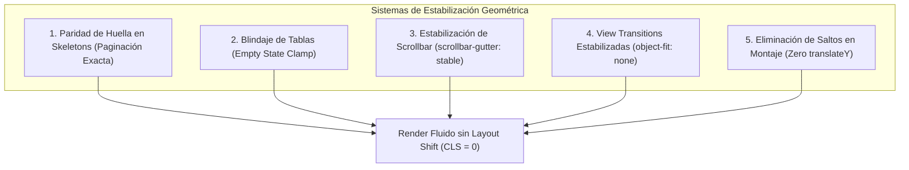

# 01. Estabilización Geométrica y Cero Layout Shift (CLS = 0)

> **Módulo:** UI & UX Engineering Patterns  
> **Tema:** Prevención de Cumulative Layout Shift (CLS) mediante paridad geométrica de esqueletos, estabilización de scrollbars y control de View Transitions.

---

## 1. El Problema del Salto de Geometría (Layout Shift)

En aplicaciones web de alto rendimiento y paneles analíticos, es común que la navegación entre distintas vistas produzca un **"brinco" brusco (vertical y horizontal)** la primera vez que se visita una ruta sin datos en memoria. Sin embargo, en subsecuentes visitas (cuando los datos ya están en caché de cliente), la transición suele ser fluida.

Este comportamiento indica una **disparidad geométrica de altura y ancho entre el primer render (estado de carga o *skeleton*) y el render final con datos reales**.

```
Frame 0 (Carga inicial sin caché):
┌──────────────────────────────────────────────┐
│  Métricas Resumen (Cards fijas: 2 filas)     │ -> ~180px
├──────────────────────────────────────────────┤
│  Esqueleto Tabla (Ficticio: 10 filas)        │ -> ~450px
└──────────────────────────────────────────────┘
Altura total del contenedor: ~630px

Frame 1 (Llegada de respuesta HTTP en 200 ms):
┌──────────────────────────────────────────────┐
│  Métricas Resumen (Nómina real: 4 filas)     │ -> ~360px
├──────────────────────────────────────────────┤
│  Tabla Real (Paginación: 25 filas)           │ -> ~1,150px
└──────────────────────────────────────────────┘
Altura total del contenedor: ~1,510px  [SALTO BRUSCO DE +880px]
```

### Síntomas perceptibles para el usuario:
1. **Salto Vertical**: El pie de página y la tabla "explotan" súbitamente hacia abajo 200 ms después de que la pantalla ya se había mostrado.
2. **Salto Horizontal (Tirón de 17px)**: En monitores de alta resolución, la página a 630px no tiene barra de desplazamiento. Al saltar a 1,510px, aparece repentinamente la barra de scroll nativa del sistema operativo (17px en Windows), desplazando todo el contenido hacia la izquierda.
3. **Deformación en View Transitions**: Las transiciones nativas del navegador (`document.startViewTransition`) capturan la imagen saliente a 1,510px y la entrante a 630px, distorsionando y estirando la interfaz durante la animación.

---

## 2. Los 5 Principios de Paridad Geométrica



### Principio 1: Paridad de Huella en Skeletons
La altura del esqueleto debe coincidir matemáticamente con el tamaño del conjunto de datos esperado.
- Si el backend devuelve páginas de **25 elementos** (`PAGE_SIZE = 25`), el componente `TableSkeleton` debe renderizar exactamente **25 filas simuladas**.
- Si una sección de métricas o cuadrícula de usuarios tiene una nómina conocida de 16 tarjetas en la sede activa, el esqueleto debe calcular dinámicamente `itemsCount = knownRoster.length || DEFAULT_COUNT`.

```tsx
// ❌ Mala práctica: Skeleton genérico de 10 filas para una tabla de 25
<TableSkeleton rows={10} />

// ✅ Buena práctica: Paridad exacta con el contrato de paginación
export const PAGE_SIZE = 25;

export function OrdersTableContainer({ data, isLoading }: TableProps) {
  if (isLoading && !data) {
    return <TableSkeleton rows={PAGE_SIZE} rowHeight={46} />;
  }
  return <OrdersTable items={data.items} />;
}
```

---

### Principio 2: Blindaje contra Colapso a Estado Vacío (`Empty State Clamp`)
Durante el ciclo de renderizado, si el hook de datos tarda 1 frame en actualizar su estado de `isLoading`, la tabla no debe colapsar a un contenedor vacío de 150px (*"No se encontraron registros"*).

```tsx
export function DataTable<T>({ items, isLoading, totalCount }: TableProps<T>) {
  // Si está cargando O si sabemos por el resumen previo que existen registros,
  // jamás renderizar el contenedor colapsado de "cero resultados"
  if (items.length === 0) {
    if (isLoading || totalCount > 0) {
      return <TableSkeleton rows={PAGE_SIZE} />;
    }
    return <EmptyStateMessage message="No se encontraron registros" />;
  }

  return (
    <div className={styles.tableContainer} style={{ minHeight: `${PAGE_SIZE * 46 + 48}px` }}>
      <table>
        {/* Renderizado de filas */}
      </table>
    </div>
  );
}
```

---

### Principio 3: Estabilización de Barra de Scroll (`scrollbar-gutter`)
Para eliminar permanentemente el salto horizontal provocado por la aparición de la barra de desplazamiento nativa:

```css
/* styles/globals.css */
html {
  /* Reserva permanentemente el espacio de la barra de scroll,
     incluso cuando la vista quepa completa en pantalla */
  scrollbar-gutter: stable;
}
```

> [!TIP]
> `scrollbar-gutter: stable` está soportado en todos los navegadores modernos y previene el desplazamiento de layouts centrados (`margin: 0 auto`) sin necesidad de trucos en JavaScript ni hacks como `overflow-y: scroll`.

---

### Principio 4: Estabilización de View Transitions
Al utilizar la API nativa de View Transitions en frameworks como Next.js o Astro, el navegador intenta ajustar la captura de salida al tamaño de la pantalla entrante. Si difieren en altura, el contenido sufre un efecto de aplastamiento o rebote de escala.

```css
/* Previene el reescalado vertical brusco durante transiciones de ruta */
::view-transition-old(root),
::view-transition-new(root) {
  animation-duration: 180ms;
  animation-timing-function: cubic-bezier(0.25, 1, 0.5, 1);
  object-fit: none;
  object-position: top left;
}
```

---

### Principio 5: Eliminación de Desplazamientos en Montaje (`Zero translateY`)
Es común utilizar micro-animaciones CSS de entrada como:
```css
/* ❌ Produce brincos al navegar entre pestañas */
@keyframes cardEntrance {
  from { opacity: 0; transform: translateY(12px); }
  to { opacity: 1; transform: translateY(0); }
}
```
En tableros donde los componentes de métricas están en la misma posición relativa en múltiples rutas, el `translateY(12px)` provoca que el usuario perciba un molesto rebote vertical cada vez que hace clic en el menú lateral.

**Regla:** Usar únicamente transición de opacidad (`fade-in`) o mantener fija la geometría de los contenedores estables.

```css
/* ✅ Suave, rápido y sin desplazamiento de coordenadas */
@keyframes cardFadeIn {
  from { opacity: 0.85; }
  to { opacity: 1; }
}
```

---

## 3. Checklist de Verificación para Desarrolladores

- [ ] ¿El número de filas del `Skeleton` coincide exactamente con la constante de paginación (`PAGE_SIZE`)?
- [ ] ¿Está declarado `scrollbar-gutter: stable` en el archivo CSS raíz?
- [ ] ¿La tabla tiene definida una altura mínima proyectada (`minHeight`) para evitar colapsar a 0 px antes de pintar datos?
- [ ] ¿Las View Transitions tienen declaradas las propiedades `object-fit: none` y `object-position: top left`?
- [ ] ¿Se eliminaron las transformaciones `translateY` en componentes que conservan su posición entre rutas hermanas?
