# 02. Transiciones de Altura Suave y Física de Colapso Asimétrico

> **Módulo:** UI & UX Engineering Patterns  
> **Tema:** Transiciones verticales continuas, sincronización pre-paint en el ciclo de vida de React y el patrón de retención temporal de nodos salientes (`data-exiting`).

---

## 1. El Fenómeno del Colapso Asimétrico

Al diseñar tablas y contenedores que cambian dinámicamente de tamaño (por ejemplo, al cambiar de fecha, categoría o aplicar filtros donde el número de registros pasa de **16 filas a 4 filas** o viceversa), los desarrolladores suelen enfrentarse a un problema visual severo:

```mermaid
flowchart TD
    subgraph Expansion [Escenario A: Expansión de 4 a 16 filas]
        E1["Nuevo dataset tiene 16 filas"] --> E2["Contenedor padre crece con transition: height 280ms"]
        E2 --> E3["overflow: hidden recorta el exceso limpiamente"]
        E3 --> E4["Resultado: 100% Suave (Sin fallos visuales)"]
    end

    subgraph Collapse [Escenario B: Contracción de 16 a 4 filas]
        C1["Nuevo dataset tiene 4 filas"] --> C2["React destruye 12 filas del DOM en 0 ms"]
        C2 --> C3["La tabla colapsa inmediatamente a 200px"]
        C3 --> C4["El contenedor tarda 280ms en cerrarse desde 650px"]
        C4 --> C5["Resultado: HUECO BLANCO VACÍO DE 450px = PARPADEO BRUSCO"]
    end
```



### ¿Por qué ocurre esta asimetría?
- **Al crecer:** El contenido entrante es mayor que la ventana del contenedor animado. Como el contenedor padre utiliza `overflow: hidden`, funciona como una persiana que se abre revelando contenido preexistente.
- **Al encogerse:** React purga instantáneamente las filas sobrantes del Virtual DOM. El fondo del contenedor blanco queda vacío durante los 280 ms que tarda la animación CSS de altura en completar su trayectoria, produciendo un salto o destello blanco perceptible.

---

## 2. La Solución en Dos Fases

Para lograr transiciones simétricas perfectas (100% fluidas tanto al expandirse como al contraerse), se aplican dos técnicas complementarias:

### Fase 1: El Componente Contenedor `SmoothHeight`
El componente mide el tamaño real de su hijo en el DOM de forma síncrona **antes de que el navegador pinte en pantalla** (*pre-paint phase*).

```tsx
// src/components/ui/smooth-height.tsx
import React, { useRef, useState, useLayoutEffect, useEffect } from "react";

const useIsomorphicLayoutEffect =
  typeof window !== "undefined" ? useLayoutEffect : useEffect;

interface SmoothHeightProps {
  children: React.ReactNode;
  durationMs?: number;
  className?: string;
}

export function SmoothHeight({
  children,
  durationMs = 280,
  className = "",
}: SmoothHeightProps) {
  const containerRef = useRef<HTMLDivElement>(null);
  const contentRef = useRef<HTMLDivElement>(null);
  const [height, setHeight] = useState<number | "auto">("auto");

  useIsomorphicLayoutEffect(() => {
    if (!contentRef.current || !containerRef.current) return;

    // Medir la altura del contenido interior
    const contentNode = contentRef.current;
    let targetHeight = contentNode.offsetHeight;

    // RESTAR la altura de los elementos marcados como salientes (data-exiting)
    const exitingNodes = contentNode.querySelectorAll('[data-exiting="true"]');
    exitingNodes.forEach((node) => {
      targetHeight -= (node as HTMLElement).offsetHeight;
    });

    // COMPENSAR BORDES: Incluir subpíxeles de borderTop y borderBottom
    const style = window.getComputedStyle(containerRef.current);
    const borderCorrection =
      parseFloat(style.borderTopWidth || "0") +
      parseFloat(style.borderBottomWidth || "0");

    setHeight(Math.max(targetHeight + borderCorrection, 40));

    // Tras finalizar la transición CSS, devolver height a 'auto'
    const timer = setTimeout(() => {
      setHeight("auto");
    }, durationMs + 20);

    return () => clearTimeout(timer);
  }, [children, durationMs]);

  return (
    <div
      ref={containerRef}
      className={className}
      style={{
        height: height === "auto" ? "auto" : `${height}px`,
        overflow: height === "auto" ? "visible" : "hidden",
        transition: `height ${durationMs}ms cubic-bezier(0.25, 1, 0.5, 1)`,
        willChange: "height",
      }}
    >
      <div ref={contentRef}>{children}</div>
    </div>
  );
}
```

> [!IMPORTANT]
> **Sincronización Pre-Paint:** Es fundamental utilizar `useLayoutEffect` (o `useIsomorphicLayoutEffect`) en lugar de `useEffect`. `useLayoutEffect` se ejecuta de manera síncrona después de todas las mutaciones del DOM pero **antes** del refresco visual de la pantalla (*browser paint*), eliminando el frame intermedio desfasado.

---

### Fase 2: El Patrón de Retención Temporal de Filas Salientes (`data-exiting`)

Cuando la nueva consulta tiene menos registros que la anterior, **no destruimos las filas sobrantes de inmediato**. Las retenemos temporalmente en un `<tbody>` secundario durante los 280 ms de la animación con opacidad atenuada (`0.4`), rellenando el espacio visual mientras la cortina inferior sube suavemente.

```tsx
// src/components/table/dynamic-records-table.tsx
import React, { useState, useEffect, useRef } from "react";
import { SmoothHeight } from "./smooth-height";
import styles from "./table.module.css";

interface RecordItem {
  id: string;
  name: string;
  amount: number;
}

export function DynamicRecordsTable({ items }: { items: RecordItem[] }) {
  const [visibleItems, setVisibleItems] = useState(items);
  const [exitingItems, setExitingItems] = useState<RecordItem[]>([]);
  const prevItemsRef = useRef(items);

  useEffect(() => {
    const prev = prevItemsRef.current;
    if (prev !== items) {
      if (items.length < prev.length) {
        // Al encogerse: Guardar las filas sobrantes como "salientes"
        const remainingExiting = prev.slice(items.length);
        setExitingItems(remainingExiting);
        setVisibleItems(items);

        // Desmontar las filas salientes una vez completada la transición (280ms)
        const timer = setTimeout(() => {
          setExitingItems([]);
        }, 280);

        prevItemsRef.current = items;
        return () => clearTimeout(timer);
      } else {
        // Al crecer o mantener: Actualización directa
        setExitingItems([]);
        setVisibleItems(items);
      }
      prevItemsRef.current = items;
    }
  }, [items]);

  return (
    <SmoothHeight className={styles.tableCardWrapper} durationMs={280}>
      <div className={styles.tableScroll}>
        <table className={styles.fixedTable}>
          <thead>
            <tr>
              <th style={{ width: "60%" }}>Concepto</th>
              <th style={{ width: "40%" }}>Monto</th>
            </tr>
          </thead>

          {/* Filas activas */}
          <tbody>
            {visibleItems.map((item) => (
              <tr key={item.id} className={styles.row}>
                <td>{item.name}</td>
                <td className={styles.number}>{item.amount}</td>
              </tr>
            ))}
          </tbody>

          {/* Filas salientes: rellenan la cortina visual durante la transición */}
          {exitingItems.length > 0 && (
            <tbody data-exiting="true" className={styles.exitingBody}>
              {exitingItems.map((item) => (
                <tr key={item.id} className={styles.exitingRow}>
                  <td>{item.name}</td>
                  <td className={styles.number}>{item.amount}</td>
                </tr>
              ))}
            </tbody>
          )}
        </table>
      </div>
    </SmoothHeight>
  );
}
```

---

## 3. Régimen de Anchos Fijos (`table-layout: fixed`)

Para evitar que las columnas de la tabla oscilen horizontalmente (efecto acordeón) mientras cambian las cifras o longitudes de texto:

```css
/* styles/table.module.css */
.fixedTable {
  table-layout: fixed;
  width: 100%;
  border-collapse: separate;
  border-spacing: 0;
}

.tableCardWrapper {
  background: #ffffff;
  border: 1px solid #e2e8f0;
  border-radius: 8px;
  box-shadow: 0 1px 3px rgba(0, 0, 0, 0.05);
}

.exitingBody {
  pointer-events: none;
}

.exitingRow {
  opacity: 0.35;
  transition: opacity 280ms ease;
}
```

---

## 4. Resumen de Beneficios

| Enfoque Tradicional | Patrón SmoothHeight + Data-Exiting |
|---|---|
| Colapso a 0 px en 0 ms con parpadeo blanco | Altura animada con curva cúbica suave (`280ms`) |
| Recálculo de anchos de columna al recibir nuevos datos | Estabilidad de columnas con `table-layout: fixed` |
| Tirones subpíxel al finalizar la animación | Compensación exacta de bordes y cambio limpio a `height: auto` |
| Hueco blanco visible al contraer el conjunto de datos | Filas salientes temporales que enmascaran la subida de la cortina |
