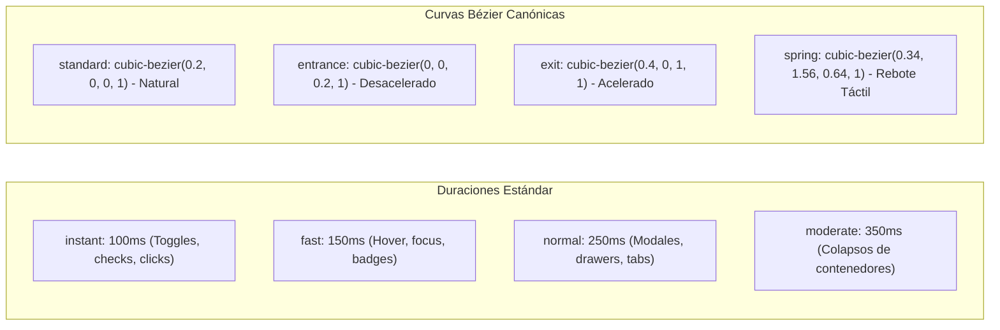

# 06. Micro-Animaciones, Tokens de Movimiento y Física de Interacción

> **Módulo:** UI & UX Engineering Patterns  
> **Tema:** Sistema canónico de tokens de movimiento, aceleración por GPU, prevención del bloqueo por `animation: ... both`, controles segmentados elásticos y rebote táctil (*spring pop*).

---

## 1. El Dilema del Movimiento en Aplicaciones de Alta Densidad

En plataformas analíticas y sistemas empresariales complejos, existen dos extremos perjudiciales:
1. **La Interfaz Rígida**: Cambios de estado instantáneos y toscos donde los elementos parpadean, desorientando al usuario sobre qué acaba de modificarse.
2. **El Exceso de Animación Pesada**: El uso de librerías en JavaScript pesadas (~40-60 KB en runtime como Framer Motion) que añaden overhead de reconciliación en React, disparan caídas de frames (*jank*) al animar tablas virtuales de miles de filas, y usan curvas de aceleración lentas (400-600 ms) que frustran la productividad del usuario.

### El Enfoque de Alto Rendimiento:
- **Cero Dependencias en Runtime**: 100% CSS nativo con aceleración por hardware (GPU).
- **Tiempos Micro-Calibrados (100 ms a 250 ms)**: El movimiento guía el ojo del usuario sin hacerle perder tiempo.
- **Tokens Canónicos Globales**: Toda la aplicación comparte las mismas curvas bézier y duraciones para transmitir una sensación coherente y sólida.

---

## 2. Sistema Canónico de Tokens de Movimiento



### Declaración en Variables CSS Globales:

```css
/* styles/tokens/motion.css */
:root {
  /* Duraciones */
  --motion-duration-instant: 100ms;
  --motion-duration-fast: 150ms;
  --motion-duration-normal: 250ms;
  --motion-duration-moderate: 350ms;

  /* Curvas de aceleración */
  --motion-ease-standard: cubic-bezier(0.2, 0, 0, 1);
  --motion-ease-entrance: cubic-bezier(0, 0, 0.2, 1);
  --motion-ease-exit: cubic-bezier(0.4, 0, 1, 1);
  --motion-ease-spring: cubic-bezier(0.34, 1.56, 0.64, 1);
}

/* Soporte de accesibilidad para preferencias de movimiento reducido */
@media (prefers-reduced-motion: reduce) {
  *, *::before, *::after {
    animation-duration: 0.01ms !important;
    animation-iteration-count: 1 !important;
    transition-duration: 0.01ms !important;
    scroll-behavior: auto !important;
  }
}
```

---

## 3. Desbloqueo de Cascada: La Trampa de `animation: ... both`

Un error recurrente al agregar animaciones de entrada en tarjetas o filas interactivas es el uso de la directiva `both` o `forwards`:

```css
/* ❌ Código problemático: Bloquea pseudo-clases en la cascada CSS */
.metricCard {
  animation: cardEntrance 300ms ease both;
  transition: transform 150ms ease, box-shadow 150ms ease;
}

.metricCard:hover {
  transform: translateY(-2px); /* ⚠️ IGNORADO: 'both' mantiene los valores finales de la animación en un nivel de especificidad superior */
}
```

### La Solución de Desbloqueo:
Para permitir que `:hover`, `:active` y `:focus` respondan inmediatamente, se debe utilizar `forwards` únicamente en propiedades no conflictivas (como `opacity`) o disociar la animación de montaje del contenedor interactivo:

```css
/* ✅ Desbloqueado: Transiciones de hover 100% fluidas */
.metricCard {
  animation: cardFadeIn 180ms var(--motion-ease-entrance) forwards;
  transition: transform var(--motion-duration-fast) var(--motion-ease-standard),
              box-shadow var(--motion-duration-fast) var(--motion-ease-standard);
  will-change: transform;
}

.metricCard:hover {
  transform: translateY(-2px);
  box-shadow: 0 4px 6px -1px rgba(0, 0, 0, 0.08);
}

.metricCard:active {
  transform: translateY(0);
}
```

---

## 4. Segmented Controls y Pestañas Elásticas (Cero Librerías JS)

Al alternar entre pestañas o categorías (ej. *"Todos"*, *"Pendientes"*, *"Procesados"*), muchos diseños intentan calcular posiciones absolutas con JavaScript (`getBoundingClientRect`), lo que produce desalineaciones cuando la fuente termina de cargar o al redimensionar la ventana.

### El Patrón de Píldora Segmentada Fluida:
Un contenedor en CSS Grid o Flexbox con botones relativos y transiciones en capas independientes de GPU:

```tsx
// src/components/ui/segmented-control.tsx
import React from "react";
import styles from "./segmented-control.module.css";

interface Option {
  id: string;
  label: string;
  badge?: number;
}

interface SegmentedControlProps {
  options: Option[];
  activeId: string;
  onChange: (id: string) => void;
}

export function SegmentedControl({ options, activeId, onChange }: SegmentedControlProps) {
  return (
    <div className={styles.segmentedContainer} role="tablist">
      {options.map((option) => {
        const isActive = option.id === activeId;
        return (
          <button
            key={option.id}
            role="tab"
            aria-selected={isActive}
            onClick={() => onChange(option.id)}
            className={`${styles.segmentButton} ${isActive ? styles.active : ""}`}
          >
            <span>{option.label}</span>
            {option.badge !== undefined && (
              <span className={styles.badge}>{option.badge}</span>
            )}
          </button>
        );
      })}
    </div>
  );
}
```

```css
/* styles/segmented-control.module.css */
.segmentedContainer {
  display: inline-flex;
  align-items: center;
  gap: 2px;
  background-color: #f1f5f9;
  padding: 3px;
  border-radius: 8px;
  border: 1px solid #e2e8f0;
}

.segmentButton {
  position: relative;
  display: inline-flex;
  align-items: center;
  gap: 6px;
  padding: 6px 14px;
  font-size: 0.8125rem;
  font-weight: 500;
  color: #64748b;
  background: transparent;
  border: none;
  border-radius: 6px;
  cursor: pointer;
  transition: color var(--motion-duration-fast) var(--motion-ease-standard),
              background-color var(--motion-duration-fast) var(--motion-ease-standard),
              box-shadow var(--motion-duration-fast) var(--motion-ease-standard);
  user-select: none;
}

.segmentButton:hover:not(.active) {
  color: #1e293b;
  background-color: rgba(255, 255, 255, 0.6);
}

.segmentButton.active {
  color: #005774;
  background-color: #ffffff;
  font-weight: 600;
  box-shadow: 0 1px 3px rgba(0, 0, 0, 0.08);
}

.badge {
  display: inline-flex;
  align-items: center;
  justify-content: center;
  padding: 1px 6px;
  font-size: 0.6875rem;
  font-weight: 600;
  background-color: rgba(0, 87, 116, 0.1);
  color: #005774;
  border-radius: 9999px;
  transition: transform var(--motion-duration-instant) var(--motion-ease-spring);
}

.segmentButton.active .badge {
  background-color: #005774;
  color: #ffffff;
  transform: scale(1.05);
}
```

---

## 5. Rebote Táctil en Controles de Selección (*Spring Pop*)

Al seleccionar filas de una tabla mediante checkboxes o marcar switches, la respuesta táctil instantánea confirma la acción al cerebro del usuario de forma inmediata:

```css
/* styles/tactile-controls.module.css */
.customCheckbox {
  appearance: none;
  width: 18px;
  height: 18px;
  border: 1.5px solid #cbd5e1;
  border-radius: 4px;
  background-color: #ffffff;
  cursor: pointer;
  display: inline-grid;
  place-content: center;
  transition: border-color var(--motion-duration-fast) var(--motion-ease-standard),
              background-color var(--motion-duration-fast) var(--motion-ease-standard),
              transform var(--motion-duration-instant) var(--motion-ease-spring);
}

.customCheckbox:hover {
  border-color: #005774;
}

.customCheckbox:active {
  transform: scale(0.9);
}

.customCheckbox:checked {
  background-color: #005774;
  border-color: #005774;
  transform: scale(1.05);
  animation: springPop 180ms var(--motion-ease-spring);
}

@keyframes springPop {
  0% { transform: scale(0.85); }
  60% { transform: scale(1.12); }
  100% { transform: scale(1.05); }
}
```

---

## 6. Checklist de Micro-Animaciones para Diseñadores y Desarrolladores

- [ ] ¿Todas las animaciones utilizan variables CSS canónicas (`--motion-duration-*` y `--motion-ease-*`)?
- [ ] ¿Se eliminó cualquier `animation: ... both` que impida el funcionamiento de `:hover` y `:active`?
- [ ] ¿Los elementos animados están promovidos a la capa de GPU (`will-change: transform, opacity`) para evitar repintados continuos del DOM (*reflows*)?
- [ ] ¿La interfaz incluye la regla `@media (prefers-reduced-motion: reduce)` para accesibilidad?
- [ ] ¿Los botones y selectores elásticos tienen duraciones de respuesta inferiores a **200 ms**?
