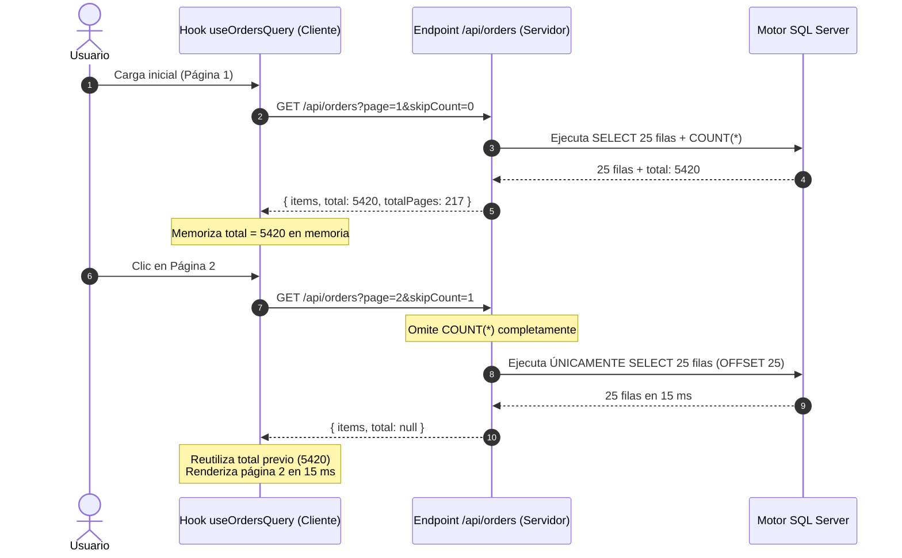

# 01. Paginación con Memoria de Conteo (`skipCount` y Poda de Conteos)

> **Módulo:** UX Architecture & Interaction Patterns  
> **Tema:** Eliminación de re-consultas de conteo global (`COUNT(*)`), memoria de total en cliente y poda de subconsultas analíticas costosas.

---

## 1. El Costo Oculto de la Paginación Tradicional

En la mayoría de las arquitecturas web, cada solicitud de paginación ejecuta **dos consultas** a la base de datos:
1. `SELECT * FROM Orders WHERE ... ORDER BY id OFFSET 25 ROWS FETCH NEXT 25 ROWS ONLY;` (Obtención de filas).
2. `SELECT COUNT(*) FROM Orders WHERE ...;` (Cálculo del total de páginas).

```
Flujo Tradicional:
Página 1: [Fetch 25 filas: 25ms] + [COUNT(*) sobre 200k filas: 800ms]  = 825ms total
Página 2: [Fetch 25 filas: 25ms] + [COUNT(*) sobre 200k filas: 800ms]  = 825ms total (¡DESPERDICIO!)
Página 3: [Fetch 25 filas: 25ms] + [COUNT(*) sobre 200k filas: 800ms]  = 825ms total (¡DESPERDICIO!)
```

### El Diagnóstico UX:
Si el usuario simplemente hace clic en "Siguiente" o pasa de la página 1 a la 2 **sin modificar los filtros ni la búsqueda**, el número total de registros es idéntico. Re-ejecutar el `COUNT(*)` en cada clic introduce entre **500 ms y 2.000 ms de latencia percibida innecesaria**.

---

## 2. La Solución: Short-Circuit con `skipCount`

El hook del cliente memoriza el `total` tras la primera respuesta. Al navegar entre páginas dentro del mismo contexto de filtrado, envía el parámetro `skipCount=1`.



---

## 3. Implementación en Hook de Cliente (React / TypeScript)

```tsx
// src/hooks/use-paginated-resource.ts
import { useState, useEffect, useRef, useCallback } from "react";

interface QueryParams {
  page: number;
  pageSize: number;
  searchTerm?: string;
  category?: string;
}

export function usePaginatedResource<T>(params: QueryParams) {
  const [items, setItems] = useState<T[]>([]);
  const [total, setTotal] = useState<number>(0);
  const [isLoading, setIsLoading] = useState(true);

  // Almacenar el total en una referencia para persistirlo entre páginas
  const cachedTotalRef = useRef<number | null>(null);
  const prevFilterKeyRef = useRef<string>("");

  // Clave que identifica si los filtros han cambiado
  const currentFilterKey = `${params.searchTerm || ""}-${params.category || ""}`;

  useEffect(() => {
    let isSubscribed = true;
    setIsLoading(true);

    const filtersChanged = currentFilterKey !== prevFilterKeyRef.current;
    if (filtersChanged) {
      // Si el filtro cambió, invalidar el total memorizado
      cachedTotalRef.current = null;
      prevFilterKeyRef.current = currentFilterKey;
    }

    // Si ya conocemos el total para estos filtros, pedir al backend omitir el COUNT
    const shouldSkipCount = cachedTotalRef.current !== null;

    const query = new URLSearchParams({
      page: params.page.toString(),
      pageSize: params.pageSize.toString(),
      ...(params.searchTerm && { q: params.searchTerm }),
      ...(params.category && { category: params.category }),
      ...(shouldSkipCount && { skipCount: "1" }),
    });

    fetch(`/api/orders?${query.toString()}`)
      .then((res) => res.json())
      .then((res) => {
        if (!isSubscribed) return;

        setItems(res.items);

        if (res.total !== null && res.total !== undefined) {
          cachedTotalRef.current = res.total;
          setTotal(res.total);
        } else if (cachedTotalRef.current !== null) {
          // Reutilizar el total memorizado
          setTotal(cachedTotalRef.current);
        }

        setIsLoading(false);
      })
      .catch(() => {
        if (isSubscribed) setIsLoading(false);
      });

    return () => {
      isSubscribed = false;
    };
  }, [params.page, params.pageSize, currentFilterKey]);

  return { items, total, isLoading };
}
```

---

## 4. Poda de Conteos en el Servidor (`buildFastCountSql`)

En endpoints analíticos complejos donde la consulta de datos incluye múltiples `LEFT JOIN`, cálculos de agregación y columnas calculadas, la consulta de conteo no debe limitarse a envolver todo el query:

```sql
-- ❌ Ineficiente: Cuenta sobre todas las columnas y cálculos
SELECT COUNT(*) FROM (
    SELECT o.id, o.monto, c.nombre, 
           DATEDIFF(day, o.created_at, GETDATE()) AS dias_mora
    FROM Orders o
    LEFT JOIN Customers c ON o.customer_id = c.id
    WHERE o.status = 'PENDING'
) AS t;

-- ✅ Consulta Podada: Solo evalúa la tabla raíz y filtros sargables
SELECT COUNT(1) AS total
FROM Orders WITH (NOLOCK)
WHERE status = 'PENDING';
```

Al detectar `skipCount === '1'`, el endpoint omite la llamada a `buildFastCountSql` por completo:

```typescript
// src/app/api/orders/route.ts
export async function GET(req: Request) {
  const { searchParams } = new URL(req.url);
  const page = parseInt(searchParams.get("page") || "1", 10);
  const skipCount = searchParams.get("skipCount") === "1";

  const [items, total] = await Promise.all([
    ordersRepo.getPage({ page, pageSize: 25 }),
    skipCount ? Promise.resolve(null) : ordersRepo.getTotalCount(),
  ]);

  return Response.json({
    items,
    total, // null si se omitió
    page,
    pageSize: 25,
  });
}
```

---

## 5. Comparativa de Rendimiento

| Métrica | Enfoque Convencional | Con `skipCount` y Poda |
|---|---|---|
| **Latencia en Página 1** | ~800 ms (Datos + Count) | ~800 ms (Datos + Count) |
| **Latencia al pasar a Página 2** | ~800 ms | **~15 ms** (Reducción del 98%) |
| **Carga de CPU en Base de Datos** | $N \times$ consultas de conteo | **1 sola consulta** de conteo por sesión de filtro |
| **Experiencia de Usuario** | Espera y parpadeo en cada clic | **Paginación instantánea continua** |
