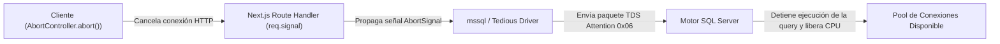

# 02. Cancelación Reactiva (`AbortController`) y Prevención de Race Conditions

> **Módulo:** UX Architecture & Interaction Patterns  
> **Tema:** Cancelación atómica de peticiones previas, mitigación de condiciones de carrera (*race conditions*), blindaje contra el destello de estado vacío (*Empty State Flash*) y propagación de paquetes TDS Attention en SQL Server.

---

## 1. El Peligro de las Condiciones de Carrera (*Race Conditions*)

En aplicaciones reactivas donde el usuario cambia rápidamente entre filtros, pestañas o escribe en un buscador:

```
T0: Usuario hace clic en "Todos"        -> Se dispara Petición A (Pesada, tarda 800ms)
T1 (200ms después): Clic en "Urgentes" -> Se dispara Petición B (Ligera, tarda 150ms)

Línea de tiempo de llegada:
T2 (350ms): Petición B responde -> La UI muestra los registros "Urgentes" correctamente.
T3 (800ms): Petición A responde -> ⚠️ SOBREESCRIBE LA PANTALLA CON "TODOS" A PESAR DE QUE EL USUARIO ESTÁ EN "URGENTES".
```

Este defecto produce desconfianza y errores operativos graves, ya que la pantalla termina mostrando datos que no corresponden a la pestaña seleccionada.

---

## 2. La Trampa del "Falso Flash de Estado Vacío" al Abortar

Al implementar `AbortController`, muchos equipos caen en un fallo visual sutil:

```tsx
// ❌ Código con defecto visual severo:
try {
  setIsLoading(true);
  const res = await fetch(url, { signal: controller.signal });
  setData(await res.json());
} catch (error) {
  // Cuando la Petición B aborta a la Petición A:
  // Petición A entra aquí con error.name === 'AbortError'
  setIsLoading(false); // ⚠️ ERROR CRÍTICO: Pone loading en false mientras Petición B aún viaja
}
```

### Síntoma:
Cuando la petición previa es cancelada, el bloque `catch` desactiva `isLoading`. Como `data` aún no tiene los resultados de la nueva petición, la interfaz muestra durante **1 a 2 segundos un cartel de *"No se encontraron registros"* antes de que llegue la respuesta real**.

---

## 3. La Solución: Guarda de Ciclo de Vida (`fetchKeyGuard`)

```tsx
// src/hooks/use-race-condition-safe-fetch.ts
import { useState, useRef, useCallback } from "react";

export function useSafeFetch<T>() {
  const [data, setData] = useState<T | null>(null);
  const [isLoading, setIsLoading] = useState(false);

  // Referencias para controlar la petición activa
  const abortControllerRef = useRef<AbortController | null>(null);
  const activeFetchKeyRef = useRef<number>(0);

  const executeFetch = useCallback(async (url: string) => {
    // 1. Cancelar la petición previa si aún está en vuelo
    if (abortControllerRef.current) {
      abortControllerRef.current.abort();
    }

    // 2. Crear nuevo controlador y avanzar el identificador de turno
    const controller = new AbortController();
    abortControllerRef.current = controller;
    const currentFetchKey = ++activeFetchKeyRef.current;

    setIsLoading(true);

    try {
      const response = await fetch(url, { signal: controller.signal });
      const result = await response.json();

      // Solo actualizar si esta petición SIGUE SIENDO la más reciente
      if (currentFetchKey === activeFetchKeyRef.current) {
        setData(result);
        setIsLoading(false);
      }
    } catch (error: any) {
      // 💡 REGLA DE ORO: Si fue un AbortError provocado por una petición posterior,
      // NO alterar el estado ni desactivar isLoading. Dejar que la nueva petición tome el control.
      if (error.name === "AbortError") {
        return; 
      }

      // Si fue un error genuino de red en la petición activa:
      if (currentFetchKey === activeFetchKeyRef.current) {
        setIsLoading(false);
      }
    }
  }, []);

  return { data, isLoading, executeFetch };
}
```

---

## 4. Propagación al Servidor y Motor de Base de Datos (TDS Attention)

Cancelar la promesa en el cliente con `controller.abort()` evita procesar la respuesta en el navegador, pero **no detiene la consulta en la base de datos** a menos que se propague explícitamente la señal al backend y al driver SQL.



### Implementación en Route Handler (Next.js / Node.js):

```typescript
// src/app/api/analytics/route.ts
import sql from "mssql";
import { getPool } from "@/lib/db";

export async function GET(req: Request) {
  const pool = await getPool();
  const request = pool.request();

  // Escuchar la cancelación del cliente
  req.signal.addEventListener("abort", () => {
    request.cancel(); // ⚡ Envía el paquete TDS Attention al motor MSSQL
  });

  try {
    const result = await request.query("SELECT * FROM HeavyAnalyticsTable");
    return Response.json(result.recordset);
  } catch (err: any) {
    if (req.signal.aborted) {
      return new Response(null, { status: 499 }); // Client Closed Request
    }
    return Response.json({ error: "Database error" }, { status: 500 });
  }
}
```

> [!TIP]
> El envío del paquete **TDS Attention (`0x06`)** interrumpe inmediatamente el hilo de ejecución en el motor relacional, liberando los cerrojos de lectura (*Shared Locks*) y evitando que consultas abandonadas colapsen el pool de conexiones en picos de alta concurrencia.

---

## 5. Checklist de Resiliencia para Desarrolladores

- [ ] ¿Cada hook de búsqueda o cambio de pestaña cancela la solicitud anterior con `abortController.abort()`?
- [ ] ¿El bloque `catch (error)` verifica `error.name === 'AbortError'` antes de tocar el estado `isLoading`?
- [ ] ¿La tabla mantiene su estructura o esqueleto sin mostrar el mensaje de "Sin resultados" mientras viaja una petición nueva?
- [ ] ¿Se pasa `req.signal` a la llamada de base de datos en el backend para liberar recursos del servidor?
