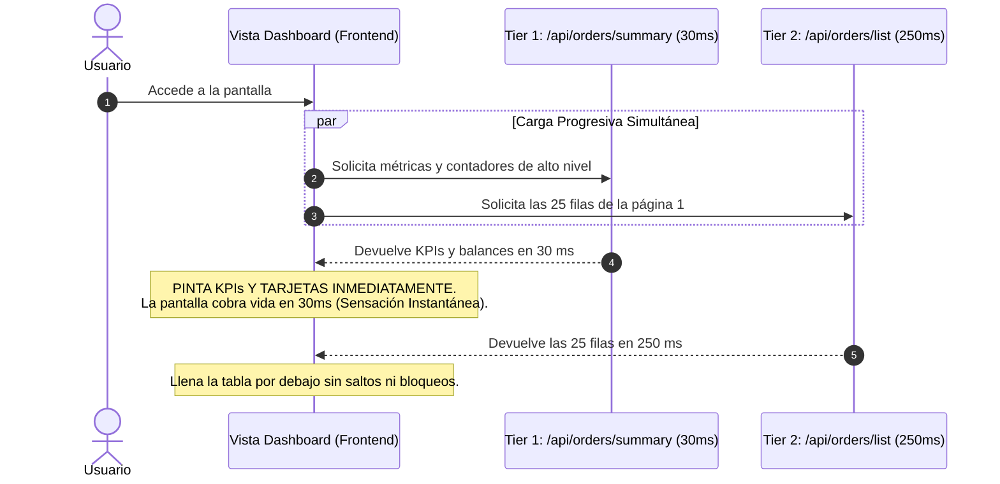

# 03. Arquitectura Two-Tier (Carga Progresiva: Resumen 30ms + Detalle)

> **Módulo:** UX Architecture & Interaction Patterns  
> **Tema:** Desacoplamiento de interfaces analíticas en dos niveles (Resumen instantáneo vs Detalle paginado), eliminación de pantallas bloqueadas y reducción drástica de la latencia percibida.

---

## 1. La Trampa de la Consulta Monolítica

En dashboards analíticos densos (donde coexisten tarjetas de KPIs, gráficos de distribución y una tabla con paginación de datos), el diseño más común y perjudicial es la **consulta monolítica**:

```
Consulta Monolítica (/api/dashboard):
[Cálculo de KPIs] + [Agrupaciones por Categoría] + [Join de 25 filas detalladas] = 3.500 ms
                                                                                   ▲
El usuario mira una pantalla en blanco con un spinner central durante 3.5 segundos ──┘
```

### El Diagnóstico de Usabilidad:
El usuario no necesita los 25 registros para empezar a orientarse. Lo primero que busca es el estado global: ¿cuántas órdenes hay pendientes?, ¿cuál es el volumen total de hoy?, ¿hay alguna anomalía en los KPIs?
Bloquear toda la pantalla hasta que la última fila detallada se procese en la base de datos es una **falla de arquitectura de interacción**.

---

## 2. La Solución en Dos Niveles (Two-Tier Architecture)

Desacoplar la vista en dos solicitudes HTTP independientes con contratos separados:



---

## 3. Implementación del Patrón en el Cliente

```tsx
// src/hooks/use-two-tier-dashboard.ts
import { useState, useEffect } from "react";

interface SummaryTier {
  totalVolume: number;
  pendingCount: number;
  approvedCount: number;
  disputedCount: number;
}

interface DetailTier<T> {
  items: T[];
  total: number;
  page: number;
}

export function useTwoTierDashboard<T>(filterDate: string) {
  const [summary, setSummary] = useState<SummaryTier | null>(null);
  const [detail, setDetail] = useState<DetailTier<T> | null>(null);
  const [isSummaryLoading, setIsSummaryLoading] = useState(true);
  const [isDetailLoading, setIsDetailLoading] = useState(true);

  useEffect(() => {
    setIsSummaryLoading(true);
    setIsDetailLoading(true);

    // ⚡ Tier 1: Resumen ultrarrápido (Índices en memoria / GROUP BY ligero)
    fetch(`/api/orders/summary?date=${filterDate}`)
      .then((res) => res.json())
      .then((data) => {
        setSummary(data);
        setIsSummaryLoading(false);
      });

    // 📋 Tier 2: Paginación detallada con relaciones completas
    fetch(`/api/orders/list?date=${filterDate}&page=1&pageSize=25`)
      .then((res) => res.json())
      .then((data) => {
        setDetail(data);
        setIsDetailLoading(false);
      });
  }, [filterDate]);

  return {
    summary,
    detail,
    isSummaryLoading,
    isDetailLoading,
  };
}
```

---

## 4. Renderizado Progresivo en la Interfaz

```tsx
// src/components/analytics/dashboard-view.tsx
import React from "react";
import { NumberFlow } from "@/components/ui/number-flow";
import { TableSkeleton } from "@/components/ui/table-skeleton";
import styles from "./dashboard.module.css";

export function DashboardView({ filterDate }: { filterDate: string }) {
  const { summary, detail, isSummaryLoading, isDetailLoading } =
    useTwoTierDashboard(filterDate);

  return (
    <div className={styles.container}>
      {/* 🚀 Tier 1: KPIs y Métricas (Se cargan en <30 ms) */}
      <section className={styles.kpiGrid}>
        <div className={styles.kpiCard}>
          <span className={styles.label}>Volumen Total</span>
          <span className={styles.value}>
            {isSummaryLoading ? (
              <span className={styles.skeletonText} />
            ) : (
              <NumberFlow value={summary?.totalVolume || 0} prefix="$ " />
            )}
          </span>
        </div>
        <div className={styles.kpiCard}>
          <span className={styles.label}>Órdenes Pendientes</span>
          <span className={styles.value}>
            {isSummaryLoading ? (
              <span className={styles.skeletonText} />
            ) : (
              <NumberFlow value={summary?.pendingCount || 0} />
            )}
          </span>
        </div>
      </section>

      {/* 📋 Tier 2: Tabla de Detalle Paginada (Se hidrata 200 ms después) */}
      <section className={styles.tableSection}>
        {isDetailLoading && !detail ? (
          <TableSkeleton rows={25} />
        ) : (
          <OrdersTable items={detail?.items || []} />
        )}
      </section>
    </div>
  );
}
```

---

## 5. Beneficios de la Arquitectura Two-Tier

| Dimensión | Enfoque Monolítico | Arquitectura Two-Tier |
|---|---|---|
| **First Contentful Paint (FCP)** | ~3.500 ms (Pantalla en blanco) | **~30 ms** (KPIs renderizados) |
| **Time to Interactive (TTI)** | ~3.500 ms | **~50 ms** (El usuario ya puede filtrar por categoría) |
| **Aislamiento de Fallos** | Si falla la tabla detallada, la pantalla muere | Si falla el detalle, los KPIs generales siguen visibles |
| **Estrategia de Caché** | Monolítica (invalida todo) | Granular (el resumen puede tener un TTL diferente al detalle) |
