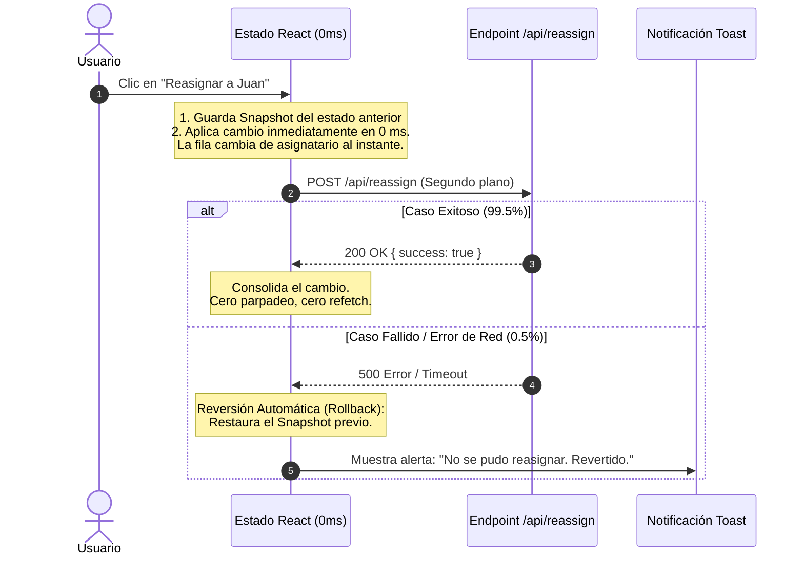

# 05. Mutaciones Optimistas en 0 ms y Rollback Transaccional

> **Módulo:** UX Architecture & Interaction Patterns  
> **Tema:** Interfaz reactiva instantánea (*Optimistic UI*), preservación de snapshots para reversión atómica (*rollback*) y reconciliación granular sin recarga destructiva.

---

## 1. El Cuello de Botella de la Confirmación Síncrona

En operaciones cotidianas de alta frecuencia (como reasignar un registro, marcar un estado de aprobación, alternar un switch o cambiar un responsable), el patrón tradicional bloquea la interfaz:

```
Flujo Tradicional (Pesimista):
[Clic del Usuario] ──> [Desactivar botón + Spinner de carga] ──> [Espera HTTP: 400ms] ──> [Refetch completo: 600ms] ──> [Refrescar pantalla]
                                                                                                                           ▲
                                                Tiempo total de bloqueo: ~1.000 ms por cada clic ──────────────────────────┘
```

### Síntoma UX:
La aplicación se siente pesada, lenta y burocrática. El usuario siente que el software "lo frena" en su jornada de trabajo diario.

---

## 2. El Principio de Mutación Optimista en 0 ms

El 99.5% de las mutaciones legítimas ejecutadas por un usuario autorizado tienen éxito en el servidor.
Por lo tanto, la interfaz debe **reflejar el cambio visualmente en 0 ms en el momento exacto del clic**, delegando la sincronización de red a segundo plano.



---

## 3. Implementación del Patrón Optimista en React 19 / TypeScript

```tsx
// src/hooks/use-optimistic-mutation.ts
import { useState, useCallback } from "react";

interface RecordItem {
  id: string;
  assignee: string;
  status: string;
}

export function useOptimisticRecords(initialItems: RecordItem[]) {
  const [items, setItems] = useState<RecordItem[]>(initialItems);
  const [pendingIds, setPendingIds] = useState<Set<string>>(new Set());

  const updateAssigneeOptimistic = useCallback(
    async (recordId: string, newAssignee: string) => {
      // 1. Guardar snapshot del estado previo para rollback seguro
      let previousRecord: RecordItem | undefined;

      setItems((prev) => {
        previousRecord = prev.find((item) => item.id === recordId);
        return prev.map((item) =>
          item.id === recordId ? { ...item, assignee: newAssignee } : item
        );
      });

      // Marcar el registro como "en tránsito" para evitar dobles clics
      setPendingIds((prev) => new Set(prev).add(recordId));

      try {
        const response = await fetch(`/api/records/${recordId}/assign`, {
          method: "PATCH",
          headers: { "Content-Type": "application/json" },
          body: JSON.stringify({ assignee: newAssignee }),
        });

        if (!response.ok) {
          throw new Error("Fallo en la persistencia del servidor");
        }

        // Éxito: el estado ya está actualizado en 0ms, no se requiere refetch
      } catch (error) {
        // ⚡ ROLLBACK: Restaurar inmediatamente el valor original
        if (previousRecord) {
          const original = previousRecord;
          setItems((prev) =>
            prev.map((item) => (item.id === recordId ? original : item))
          );
        }

        // Notificar al usuario sin modales bloqueantes
        console.error("Error al reasignar registro:", error);
      } finally {
        setPendingIds((prev) => {
          const next = new Set(prev);
          next.delete(recordId);
          return next;
        });
      }
    },
    []
  );

  return { items, pendingIds, updateAssigneeOptimistic };
}
```

---

## 4. Prevención de Condiciones de Carrera en Mutaciones Dobles

Para evitar que un usuario haga clic múltiples veces seguidas sobre el mismo elemento mientras la primera llamada HTTP sigue en vuelo:

```tsx
export function RecordRowItem({ item, pendingIds, onAssign }: Props) {
  const isMutating = pendingIds.has(item.id);

  return (
    <tr className={isMutating ? styles.rowMutating : styles.row}>
      <td>{item.id}</td>
      <td>
        <span className={styles.assigneeBadge}>
          {item.assignee}
          {isMutating && <span className={styles.syncIndicator} title="Sincronizando..." />}
        </span>
      </td>
      <td>
        <button
          disabled={isMutating}
          onClick={() => onAssign(item.id, "Carlos")}
          className={styles.actionBtn}
        >
          Reasignar
        </button>
      </td>
    </tr>
  );
}
```

```css
/* styles/optimistic.module.css */
.syncIndicator {
  display: inline-block;
  width: 6px;
  height: 6px;
  margin-left: 6px;
  border-radius: 50%;
  background-color: #00769e;
  animation: pulse 1s infinite alternate;
}

@keyframes pulse {
  from { opacity: 0.3; transform: scale(0.8); }
  to { opacity: 1; transform: scale(1.2); }
}
```

---

## 5. Comparativa de Percepción de Velocidad

| Aspecto | Enfoque Pesimista Clásico | Mutación Optimista en 0 ms |
|---|---|---|
| **Tiempo de Respuesta Visual** | 400 ms - 1.200 ms | **0 ms (Instantáneo)** |
| **Bloqueo de Interfaz** | El usuario debe esperar el spinner | **Cero bloqueo**; puede continuar con la siguiente fila |
| **Gestión de Errores** | Muestra el error pero interrumpe el flujo | Revierte suavemente (*rollback*) con feedback puntual |
| **Carga en Servidor** | Requiere `refetch()` global de toda la tabla | **Cero refetch**; solo procesa la mutación puntual en $O(1)$ |
